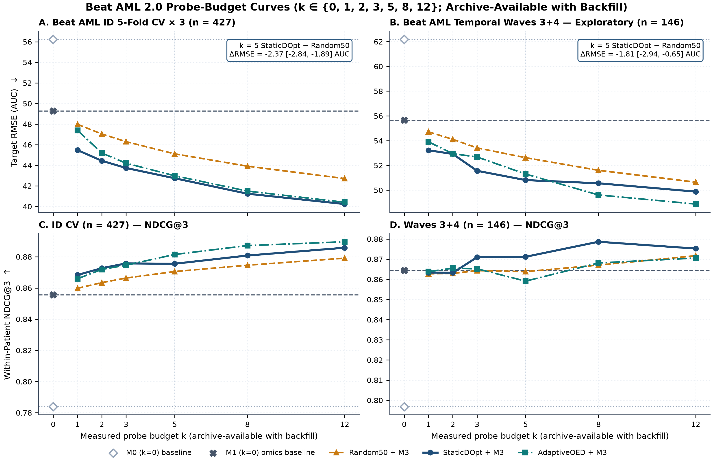
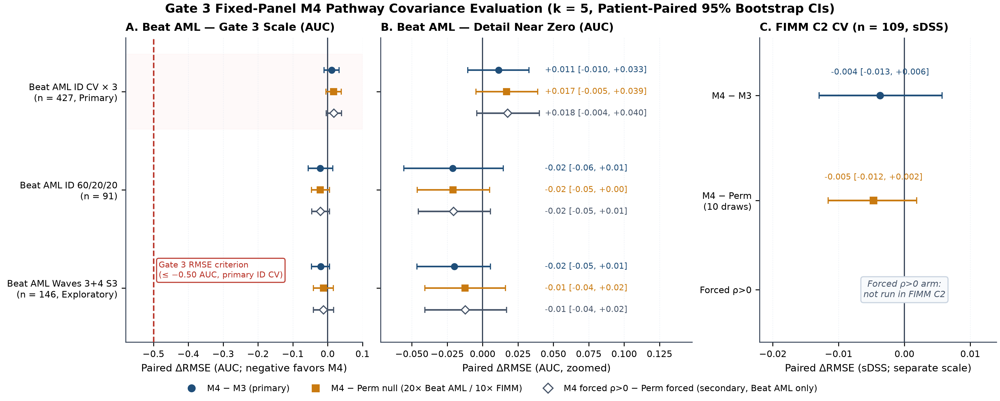
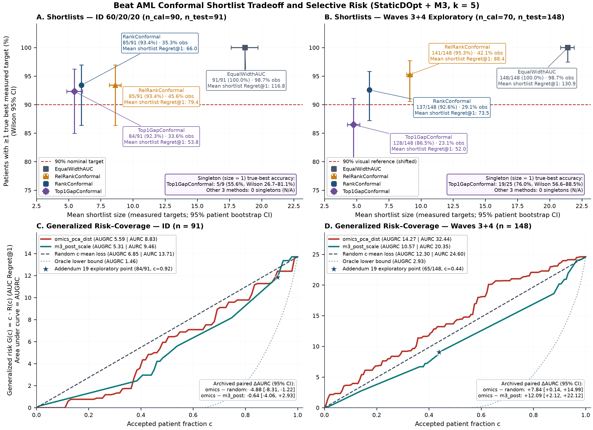
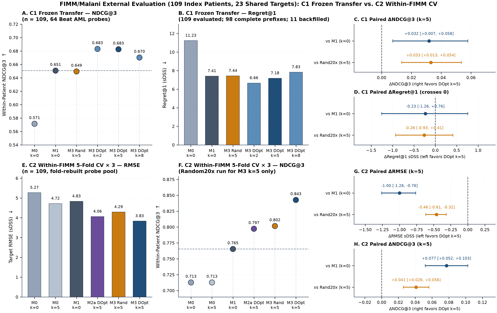

# Empirical Evaluation of Budget-Constrained Ex Vivo Drug Panel Selection and Patient-Level Conformal Shortlists in Primary Acute Myeloid Leukemia

**Author:** Muhammed Emin Çelik¹*  
¹ Independent Researcher · ORCID: https://orcid.org/0009-0003-9804-0640  
\* Correspondence: memineminm120@gmail.com  
**Code & Archive:** https://github.com/Zwannfrederick/oncotwin (release tag `v1.0.0`: https://github.com/Zwannfrederick/oncotwin/releases/tag/v1.0.0)  
**Article Type:** New Results (Empirical Computational Study — Research Use Only)  
**License (Manuscript, Figures, Derived Data):** CC BY-NC 4.0 · **License (Code):** PolyForm Noncommercial 1.0.0  

> **Scope and Non-Clinical Notice:** All results in this study come from retrospective *ex vivo* 72-hour drug sensitivity archives. Nothing in this manuscript supports clinical diagnosis, treatment selection, or patient care.

---

## Abstract

Specimen availability can limit the number of compounds tested *ex vivo* on primary acute myeloid leukemia (AML) cells, yet predicting drug sensitivity from baseline RNA sequencing and somatic mutations alone leaves substantial error. Under written internal protocols frozen before their designated runs, we tested an empirical question on retrospective primary AML archives: if a laboratory measures *k* probe drugs (focusing on *k* = 5) on a patient's cells, how much does that improve prediction and ranking of prespecified AML assay targets, how compact can a patient-level conformal candidate shortlist get, and where do pathway priors, adaptive selection, out-of-distribution (OOD) abstention, and cross-cohort transfer break down?

Using retrospective archives, we evaluated a training-derived probe ranking (`StaticDOpt`) paired with a conditional Gaussian residual update (`M3`) that backfilled unavailable probes with measured compounds from the training ranking (exact locked five-probe prefix availability: 19/93 in Beat AML ID holdout, 1/163 in Sprint 4 `Waves 3+4`, 0/146 in Sprint 3 `Waves 3+4`, and 98/109 in FIMM). Across Beat AML 2.0 (471 unique index AML patients, 24 prespecified AML assay targets, patient-disjoint cross-validation and temporal `Waves 1+2 → Waves 3+4` holdout), five archive-available probes reduced target RMSE in the specified comparisons: on the 60/20/20 holdout (*n* = 91), the paired RMSE difference for `StaticDOpt + M3` (*k* = 5) versus baseline omics (`M1`) was −7.29 AUC units [95% CI −9.45, −5.42]; in 5-fold cross-validation (*n* = 427), `StaticDOpt` differed from 50× equal-budget random panels by −2.37 AUC units [−2.84, −1.89]. Patient-level rank calibration (`RankConformal`, nominal 90%) reduced mean shortlist size from 18.70 drugs (98.7% of observed targets; 91/91 containment) under equal-width AUC intervals to 6.00 measured targets while empirically including a true best observed target in 85/91 (93.4%) internal test patients and 137/148 (92.6%) exploratory temporal `Waves 3+4` patients.

In an independent Finnish AML archive (FIMM/Malani, Zenodo 7370747; 132 specimens / 109 unique index patients, 23 shared targets), frozen Beat AML transfer (`C1`, 64 shared Beat AML training probes, no model refitting or cohort-level fitting in our transfer pipeline, upstream batch-corrected FIMM RNA) improved top-three ranking quality (`ΔNDCG@3` = +0.032 [+0.007, +0.058] vs `M1`; +0.033 [+0.013, +0.054] vs `Random20x`), whereas the 95% confidence interval for first-ranked-drug regret (`Regret@1`) included zero (−0.23 sDSS [−1.26, +0.76] vs `M1`). In a separate within-FIMM 5-fold cross-validation refit (`C2`, *n* = 109, fold-rebuilt probe pool), five probes improved both error and ranking (`ΔRMSE` = −1.00 sDSS [−1.26, −0.76] vs `M1`; −0.46 [−0.61, −0.32] vs `Random20x`).

We also report four negative findings: (1) shrinking residual covariance toward curated drug-family annotations (`M4`) did not meet the −0.50 AUC Gate 3 threshold (+0.011 AUC [−0.010, +0.033] vs `M3` and +0.017 [−0.005, +0.039] vs 20-draw degree-preserving permuted family graphs in Beat AML ID CV; −0.00 sDSS [−0.01, +0.01] vs `M3` and −0.00 [−0.01, +0.00] vs 10-draw permutations in FIMM `C2`), leading to a `NO-GO` decision deferring kinetic ODE development; (2) patient-adaptive batch selection (`AdaptiveOED`) yielded `INSUFFICIENT_EVIDENCE` versus `StaticDOpt` after symmetric Holm correction; (3) omics-distance OOD abstention ranked patients worse than random on `Waves 3+4` (`AURC` 32.44 vs 24.60; `AUGRC` 14.27 vs 12.30); and (4) adaptive margin shortlists (`Top1GapConformal`) contained a true best observed target in only 5/9 (in-distribution) and 19/25 (`Waves 3+4`) patients within the singleton (`|S| = 1`) subgroup despite >86% marginal coverage. All code, frozen internal protocols, and SHA-256 verification manifests run on CPU with three runtime dependencies.

---

## 1. Introduction

Primary *ex vivo* drug sensitivity testing in acute myeloid leukemia (AML) measures how viable patient blast cells remain after short-term exposure to targeted and cytotoxic compounds, as demonstrated in Beat AML 2.0 (Bottomly et al., 2022) and the Finnish Functional Precision Medicine Tumor Board (Malani et al., 2022). Specimen availability and assay capacity can restrict how many compounds are tested per patient sample. Conversely, predicting drug response solely from baseline RNA sequencing and somatic mutations remains noisy, is sensitive to cross-cohort shifts, and can be overstated when benchmarks fail to control for drug-mean baselines, repeated patient specimens, or assay differences across centers (Bernett et al., 2026; Willoch-Allen et al., 2026).

This project began from a broader interest in mechanistic "digital twin" models for personalized cancer therapy, then narrowed its scope to a directly testable empirical core. We did not estimate kinetic parameters from these data; sparse viability observations motivate an identifiability analysis for any future dynamic model (Raue et al., 2009), and rigorous drug-response benchmarking requires explicit baseline and transfer controls (Bernett et al., 2026). We therefore examined five empirical questions in primary AML archives:

1. **Few-shot signal:** Under a retrospective archive-available probe budget of *k* drugs on a patient's cells, how much does predicting prespecified AML assay targets improve over drug-mean (`M0`) and baseline omics (`M1`) models?
2. **Panel design:** Does a training-derived batch panel ranking (`StaticDOpt`, `StaticDiversity`, or `AdaptiveOED`) beat equal-budget random panels, and does patient-adaptive selection justify its extra complexity?
3. **Pathway structure (`Gate 3`):** Does shrinking residual drug covariance toward curated drug-family annotations (`M4`) beat unstructured empirical shrinkage (`M3`) and a degree-preserving permuted family graph?
4. **Uncertainty and shortlists:** Can patient-level conformal calibration produce compact candidate shortlists that contain a true best observed target, and does out-of-distribution (OOD) abstention work across enrollment waves?
5. **External transfer:** How much ranking signal transfers frozen (without refitting or target-cohort fitting in our transfer pipeline) from Beat AML (MTS assay, AUC) to FIMM (CTG assay, sDSS), versus refitting the same workflow within FIMM?

We do not claim a new statistical algorithm. Every component uses standard regularized linear algebra, greedy D-optimal design, and split-conformal order statistics. Our contribution is a leakage-controlled empirical evaluation conducted under written internal protocols across two primary AML archives, reporting both positive and negative outcomes.

---

## 2. Methods

### 2.1 Cohorts, Specimen Deduplication, and Target/Probe Disjointness

- **Beat AML 2.0 (Bottomly et al., 2022; CC BY 4.0):** Seven harmonized files were downloaded with SHA-256 verification from the official Beat AML 2.0 repository. Auditing identified 942 clinical specimens across 805 unique patients (`dbgap_subject_id`), including 108 patients with multiple specimens (up to 5). Across enrollment-wave labels, **13 patients appeared directly in both `Waves 1+2` and `Waves 3+4`** (plus 4 in `Both` and `Waves 1+2` and 1 in `Both` and `Waves 3+4`, totaling **18 patients** spanning multiple cohort labels). All splits were strictly patient-disjoint. Among 520 drug-plus-RNA specimens (479 unique patients), we retained one deterministic index specimen per patient **without inspecting drug-response labels** (`select_index_specimen_positions`), ordered by: (1) earliest `timeOfSampleCollectionRelativeToInclusion` (missing last), (2) `diseaseStageAtSpecimenCollection` (`Initial Diagnosis` before `Relapse`, `Residual`, `Unknown`, `Remission`), (3) presence of DNA sequencing (`dbgap_dnaseq_sample`), (4) `specimenType` (`Bone Marrow Aspirate` before `Peripheral Blood`), and (5) ascending `specimen_key`. Filtering to AML yielded **471 unique index AML patients**, 166 total inhibitors, and **24 prespecified AML assay target drugs** (lower probit AUC = higher sensitivity).
- **FIMM / Malani AML (Malani et al., 2022; secondary dataset Zenodo 7370747, CC BY 4.0):** The clinical tumor-board framework is reported by Malani et al. (2022); the secondary dataset analyzed here is the Zenodo 7370747 archive (`38,810,683` bytes, MD5 `3db5280e20f315d56d6bf07dd6a9e241`), containing 252 specimens from 186 AML patients (`File_0`), 515 drugs × 181 columns in `File_3.1` (164 AML + 17 healthy), and 167 RNA log2-CPM columns in `File_7` (163 AML + 4 healthy CD34+ controls). Intersecting AML RNA and sDSS yielded **132 specimens from 109 unique patients** (92 single-specimen, 17 multi-specimen), 14,688 shared Ensembl genes, and 15 shared binary driver mutation columns (`KIT` absent in FIMM `File_6`). FIMM used its own deterministic index specimen rule (`select_fimm_index_specimen_positions`), ordering multi-specimen patients by: (1) `Disease status`, (2) `Tissue`, (3) descending count of matched observed drugs (`n_obs_matched_drugs`), and (4) ascending `Sample_ID`. Exact 1-to-1 compound matching covered 102/166 Beat AML drugs, **23/24 targets** (`Gilteritinib` absent), and **64 shared probes** from Beat AML's all-471 training probe pool (used in `C1`). In 11 of 23 shared targets, maximum tested concentrations differed between cohorts (0.01× to 10×; e.g., Trametinib 40× lower and Rapamycin 100× lower in FIMM). To align response direction with Beat AML AUC (lower = more sensitive), FIMM sDSS scores (Yadav et al., 2014) were negated (`y_aligned = -sDSS`; negation aligns direction without asserting numerical scale equivalence between AUC and sDSS).
- **Strict probe/target separation:** In every experiment, the candidate probe pool was chosen strictly inside the training fold (`min_train_obs = 100` in Beat AML; `min_train_obs = 50` inside each FIMM training fold in `C2`; the 64-probe Beat AML training pool in `C1`) and was strictly disjoint from the target drug set. Probes were never scored in evaluation metrics.

### 2.2 Frozen Internal Protocols, Splits, and Leakage Prevention

Written internal protocols (`docs/PROTOCOL*.md`) were frozen before their designated runs; no external public timestamped registry was used prior to the initial repository commit, and exploratory analyses or deviations from initial plans are explicitly separated below and in `docs/METHODS_REPORT.md`:
1. **Beat AML ID 5-Fold CV × 3 seeds** (`n_eval = 448` in Sprint 2; `427` in Sprints 3 and 5 under `min_targets = 5, min_probes = 12`).
2. **Beat AML temporal OOD (`Waves 1+2 → Waves 3+4`):** All patients appearing in `Waves 1+2` or `Both` were excluded from the `Waves 3+4` test set (`n_eval = 148` in Sprint 2; `146` in Sprint 3 and Sprint 5 A1; `148` in Sprint 4 and Sprint 5 B). Because `Waves 3+4` was inspected in Sprints 2–3 (including an exploratory Sprint 3 v2 probe-availability sensitivity check), it is designated an **exploratory temporal OOD stress test** in Sprints 4–5: it was excluded from all Sprint 4–5 model fitting and threshold calibration, and served only as an exploratory directional sign check in Gate 3.
3. **Beat AML 60/20/20 split (Sprints 4–5):** Patient-disjoint train/tune (`284`), calibration (`94`; `90` archive-eligible), and test (`93`; `91` archive-eligible) for ID; and `213` train/tune, `71` calibration (`70` archive-eligible after `min_targets = 5, min_probes = 8`; `SOL-14`), and `165` test (`148` archive-eligible) for `Waves 3+4`.
4. **Leakage controls:** In Beat AML CV/holdout and FIMM `C2`, every gene filter (top 2,000 high-variance genes), feature standardization, ridge hyperparameter, covariance matrix, and panel ranking was fit exclusively inside training folds (frozen cross-cohort transfer `C1` uses within-sample RNA rank normalization and per-patient probe z-scoring on upstream batch-corrected FIMM RNA; Section 2.5). Adversarial tests confirmed that permuting hidden test target responses or adding zero-mean Gaussian noise (`SD = 500` AUC) left probe selections and target predictions bit-for-bit unchanged.

### 2.3 Models, Batch Panel Selection, and Pathway Control (`M4`)

- **`M0` (Fair few-shot drug/patient mean):** `y_hat_{p,d} = mu + b_d + b_p^(S_p)` with shrunk patient offset from observed probes `S_p` (`k = 0` uses `mu + b_d` only).
- **`M1` (Baseline omics ridge):** Dual-space L2-regularized regression on top-2,000 training RNA features plus binary mutation/clinical indicators, predicting drug residuals over `mu + b_d` with inner patient-disjoint CV.
- **`M2a` / `M2b` (Omics-free few-shot):** Conditional Gaussian shrinkage (`M2a`) and low-rank SVD (`M2b`) on drug-mean residuals.
- **`M3` (Hybrid omics prior + conditional Gaussian update):** Uses `M1` out-of-fold (OOF) predictions on training patients to form residual matrix `R = Y - Y_hat_M1`, estimates a positive-semidefinite shrunk covariance `Sigma_hat = (1 - alpha) * S_psd + alpha * diag(S_psd)`, and updates unseen target drugs for a new patient from `k` observed probe residuals `r_S` via `delta_T = Sigma_{TS} (Sigma_{SS} + lam * I)^{-1} r_S`.
- **Batch panel selectors (single round, fixed budget *k*):** `Random` (50× in Beat AML; 20× in FIMM for `M3, k = 5` only), `StaticDiversity` (greedy max-min correlation distance), `StaticDOpt` (greedy log-det / conditional target variance reduction using training `Sigma_hat`), `EqualWeightVarRed` (Sprint 4 control), and `AdaptiveOED` (patient-specific expected top-contender weights via locked per-fold Monte Carlo noise bank, `SOL-09`). In primary `archive_available` evaluation, the ordered training ranking selects the patient's first *k* observed probes (backfilling unavailable prefix entries); in Sprint 4 `locked_train_catalog`, missing prefix probes trigger technical abstention without backfill.
- **`M4` (Pathway/drug-family structured covariance & Gate 3):** Using `beataml_drug_families.xlsx` (`drug_family` sheet: 117/166 annotated drugs, 86 families, 395 incidence edges; 15/24 targets annotated), we built a unit-diagonal cosine similarity Gram matrix `G` and replaced diagonal shrinkage with `T_bio = diag(sd) * ((1 - rho) * I + rho * G) * diag(sd)` (`rho in {0, 0.15, 0.30, 0.50, 0.70}`). When `rho = 0`, `M4` equals `M3` bit-for-bit. As a structural specificity control (`M4_perm_null`), we averaged **20** independent bipartite edge-swap permutations in Beat AML A1 and **10** independent draws in FIMM `C2` (`run_sprint05_fimm.py`), preserving every drug's exact degree and every family's exact size. Primary **Experiment A1** held patients, targets, and the `StaticDOpt(M3)` panel fixed; secondary **Experiment A2** also reselected the panel with `M4`. Internal **Gate 3 (`AD-001`)** required `ΔRMSE <= -0.50` AUC (patient-paired 95% CI `< 0`, `p < 0.05`) against both `M3` and `M4_perm_null` on Beat AML ID CV, no ranking degradation for `M4` versus `M3`, plus negative direction on exploratory `Waves 3+4`; FIMM `C2` served as a complementary check on the sDSS scale.

### 2.4 Patient-Level Conformal Shortlists and Selective Risk (`AURC` / `AUGRC`)

All uncertainty calibration used the separate calibration split with patients as the exchangeable unit at nominal coverage `1 - alpha = 0.90` (`alpha = 0.10`), using exact finite-sample order statistic `r = ceil((n_cal + 1)(1 - alpha))` (returning NaN whenever `r > n_cal`). Under standard split-conformal calibration (Lei et al., 2018; grouping specimens at the patient level follows the hierarchical-unit framing of Lee et al., 2023), the marginal coverage guarantee holds for exchangeable eligible test patients under the same fixed prediction policy and target-observation mechanism (`O_i`). It does not transfer automatically to unmeasured targets, temporal shift (`Waves 3+4`), or conditional subgroups such as singletons (`|S| = 1`). Under true-best ties, calibration uses the worst predicted score/rank among all tied true-best observed targets, whereas evaluation counts a shortlist as covering if it contains at least one true-best observed target:
- **`EqualWidthAUC` (Sprint 4 baseline):** Calibrates `q_sim` on each calibration patient's maximum absolute residual across observed targets, then retains every observed target satisfying `y_hat_d - y_hat_(1) <= 2 * q_sim`.
- **`RankConformal` (primary shortlist):** Calibrates integer `k_hat` on the predicted rank of each calibration patient's true best observed target, outputting the top `k_hat` predicted observed targets (including predicted ties).
- **`RelRankConformal`:** Same calibration on relative rank `r_i / n_obs,i`, taking `ceil(q_rel * n_obs)`.
- **`Top1GapConformal` (adaptive margin comparator):** Calibrates `m_hat` on `y_hat_{d*_i} - min_d y_hat_d`, retaining observed targets within `m_hat` AUC of the predicted best target. Produces variable shortlist sizes including singletons (`|S| = 1`).
- **OOD abstention (`AURC` / `AUGRC`):** Evaluated omics PCA distance (`omics_pca_dist`) and `M3` conditional posterior standard deviation (`m3_post_scale`) via tie-aware Area Under the Risk–Coverage curve (`AURC`) and an adaptation of Area Under the Generalized Risk–Coverage curve (`AUGRC`, adapted from selective classification in Traub et al., 2024 to continuous `Regret@1` loss). Patients are sorted in ascending order of the abstention score, tied scores are added jointly, acceptance rate is `c = m / n`, and generalized risk `G(c) = c · R(c) = (1/n) sum_{i in A_c} loss_i` is integrated by the trapezoidal rule from `(0, 0)` (giving exact random expectation `c · mean(Regret@1)` and random `AUGRC = 0.5 · mean(Regret@1)`).

### 2.5 External FIMM Replication (`C1`, `C2`) and Beat AML Probe-Scale Sensitivity (`OPUS-028`)

- **Experiment C1 (Frozen Beat AML transfer):** No model refitting or cohort-level parameter fitting was performed in our transfer pipeline; however, upstream batch-corrected FIMM `File_7` RNA values were used (`SOL-16`). Inspired by within-sample relative expression (Tercan, 2026), each specimen's 14,688-gene RNA profile was rank-normalized independently within that single specimen (`within_sample_rank_normalize`). Within each specimen, ties in RNA expression were broken by feature-column order (`OPUS-029`: 19.5% tied entries per Beat AML row, ~0% in FIMM; mean absolute difference versus average-rank tie breaking on the normalized RNA input was 2 × 10⁻⁵, max 0.0016 on [0, 1]; prediction-metric equivalence under alternative tie rules was not separately evaluated). Beat AML training responses were row z-scored per patient across observed shared drugs; `M0`, `M1`, `M2a`, `M3`, and the 64-probe common-catalog `StaticDOpt` ranking were fit solely on Beat AML (471 patients). On FIMM, each test patient's `k` observed probes were z-scored using only those `k` values (targets and other patients strictly hidden). Beat AML conformal intervals were **not** transferred (`conformal_intervals_transferred = False`). Evaluated on 109 unique index patients (primary) and all 132 specimens clustered into 109 patient means (sensitivity).
- **Experiment C2 (Within-FIMM method replication — separate from C1):** Patient-disjoint 5-fold CV × 3 seeds refit entirely within FIMM on the 109 unique index patients directly on `-sDSS`, fitting gene filters, models (`M0`, `M1`, `M2a`, `M3`, `M4`, `M4_perm_null` with 10 draws), the candidate probe pool (`min_train_obs = 50`), and `StaticDOpt` inside each FIMM training fold. In both `C1` and `C2`, `Random20x` was executed only for `M3, k = 5` (`M2a` random and `k = 2, 8` random arms were not run; `SOL-16`).
- **Beat AML probe-scale sensitivity (`OPUS-028`):** Using C1-style normalization in a separate Beat AML sensitivity experiment on the frozen 60/20/20 split (`284` train, `94` unused calibration, `91` evaluable test of `93` target-eligible, 102 shared drugs, 23 targets, 62 training-only shared probes), we compared feasible probe-scaling rules (`train_reference`, `k_center`, `k_probe`) against `M1_k0` and a non-deployable `full_row_oracle` diagnostic (which uses held-out patient target responses) at `k = 2` and `k = 5`.

### 2.6 Statistical Inference

All metrics (`RMSE`, residual `R²`, within-patient tie-aware `NDCG@3`, `Recall@3`, `Regret@1`, `Regret@3`, and Spearman correlation) were aggregated at the patient level first (never treating CV seeds or random panel draws as independent patients). Paired differences used patient-clustered bootstrap confidence intervals (1,000 resamples in main runs; 2,000 in `OPUS-028`; 4,000 in audit checks). Bootstrap intervals condition on fixed OOF/test predictions, do not include outer fold-refit variance, and—outside the Sprint 3 nine-test Holm family (Holm, 1979)—are unadjusted for multiplicity.

### 2.7 Ethics, Availability, Funding, Competing Interests, and AI Tool Disclosure

- **Ethics:** This study analyzed only publicly available, de-identified secondary datasets (Beat AML 2.0 and Zenodo 7370747, both CC BY 4.0). No new human specimens were collected and no clinical interventions were performed.
- **Code, data, and reproducibility:** All code, frozen internal protocols, unit/contract tests (`RuntimeWarning` promoted to error), SHA-256 verification manifests (32 archived files), deterministic figure scripts (`make_figures.py`), and the one-command verifier (`verify_package.py`) are publicly available at https://github.com/Zwannfrederick/oncotwin (immutable release tag `v1.0.0`: https://github.com/Zwannfrederick/oncotwin/releases/tag/v1.0.0) under `PolyForm-Noncommercial-1.0.0` (code, including `audits/**/*.py`) and `CC BY-NC 4.0` (documents, figures, derived `data/processed/` outputs, and non-code audit records; raw data are fetched directly from official sources). Runtime uses CPU only with three Python dependencies (`numpy==2.5.5`, `pandas==3.0.3`, `openpyxl==3.1.5` + `pytest==9.2.0`; optional `matplotlib==3.11.2` in `requirements-figures.txt` for figures). On a single Linux x86_64 machine (`Python 3.14.10`), clean virtual environment verification passed (`88` core tests in `14.8–15.6 s`; `91` tests including `fetch_fimm` 5xx retry and deterministic figure tests with `requirements-figures.txt`); separate full Sprint 5 CPU execution took `244–251 s` with peak RSS `599 MB`. Other operating systems and Python 3.11–3.13 were not separately tested.
- **Funding and competing interests:** This research received no external funding. The author declares no competing financial or non-financial interests.
- **Author accountability and AI tool disclosure:** Muhammed Emin Çelik is the sole author and is accountable for the study and its interpretation. He defined the research question and made the decisions on study scope, controls, and reporting. Three AI models were used as tools and are not authors: **Gemini 4 Neon** assisted with pipeline implementation, figure generation, and packaging; **GPT-6.2 Sol** assisted with protocol and leakage checks, analysis code (`OPUS-028`), reference and claim auditing, and drafting scientific text; **Claude Opus 5.5** assisted with edge-case tests, profiling, refactoring, numerical auditing, and separate in-project reproducibility reruns. The author reviewed the analyses, references, and manuscript and assumes full responsibility for the final version. The AI-assisted checks were internal error-detection procedures and did not constitute independent academic peer review.

---

## 3. Results

### 3.1 Prediction Error with Five Probes in Beat AML

In Beat AML 2.0, permutation leakage checks passed (`clean_wave_perm` per-drug Spearman `+0.013 [-0.052, +0.079]`). Adding five archive-available *ex vivo* probes via `M3` lowered target RMSE and improved within-patient ranking across the specified Beat AML comparisons (Table 1; **Figure 1**).

**Table 1. Beat AML 2.0 prediction and archive-available panel selection results (`k = 5` reference).**

| Evaluation Regime | Evaluable Patients (*n*) | Arm / Comparison | RMSE (AUC) ↓ | NDCG@3 ↑ | Regret@1 (AUC) ↓ | Paired ΔRMSE [95% CI] |
|---|---:|---|---:|---:|---:|---:|
| Sprint 2 ID 5-Fold CV × 3 | 448 | `M0 (k=0)` | 55.85 | 0.785 | — | — |
| Sprint 2 ID 5-Fold CV × 3 | 448 | `M1 (k=0)` | 49.07 | 0.855 | — | — |
| Sprint 2 ID 5-Fold CV × 3 | 448 | `M3 (k=5, random)` vs `M1 (k=0)` | 44.78 | 0.869 | — | **−4.29 [−4.98, −3.60]** |
| Sprint 3 v2 ID 5-Fold CV × 3 | 427 | `Random50 + M3 (k=5)` | 45.11 | 0.871 | 24.0 | — |
| Sprint 3 v2 ID 5-Fold CV × 3 | 427 | `StaticDOpt + M3 (k=5)` vs `Random50` | **42.74** | 0.876 | 23.8 | **−2.37 [−2.84, −1.89]** |
| Sprint 3 v2 ID 5-Fold CV × 3 | 427 | `AdaptiveOED + M3 (k=5)` vs `StaticDOpt` | 42.98 | 0.881 | 21.6 | +0.24 [−0.33, +0.81] |
| Sprint 3 v2 `Waves 3+4` (OOD) | 146 | `StaticDOpt + M3 (k=5)` vs `Random50` | **50.81** | 0.871 | 28.9 | **−1.81 [−2.94, −0.65]** |
| Sprint 4 v2 ID 60/20/20 | 91 | `StaticDOpt + M3 (k=5)` vs `M1 (k=0)` | **39.84** | 0.887 | 13.7 | **−7.29 [−9.45, −5.42]** |
| Sprint 4 v2 `Waves 3+4` (OOD) | 148 | `StaticDOpt + M3 (k=5)` vs `M1 (k=0)` | **51.99** | 0.873 | 24.6 | **−4.18 [−5.86, −2.66]** |

Two caveats emerged from Sprint 3 and Sprint 4 audits:
1. **Static vs. Adaptive:** Across nine symmetric Holm-adjusted paired tests (`k in {3, 5, 8} × {RMSE, NDCG@3, Regret@1}`; Holm, 1979), `AdaptiveOED` versus `StaticDOpt` yielded **`INSUFFICIENT_EVIDENCE`** in both ID CV and `Waves 3+4` (where at `k = 8`, `AdaptiveOED` had lower RMSE `49.61` vs `50.56` but lower `NDCG@3` `0.868` vs `0.879`). We therefore retained `StaticDOpt` as the simpler working reference (`AD-008`).
2. **Archive availability vs. locked catalog:** On `Waves 3+4`, two top `Waves 1+2` probes (`XAV-939`: 0/146; `ABT-737`: 3/146) were nearly absent in later waves, reducing exact locked five-probe panel availability to **0/146** in Sprint 3 v2 `Waves 3+4`, **19/93** in Sprint 4 v2 ID (`locked_train_catalog`), and **1/163** in Sprint 4 v2 `Waves 3+4`. Reported archive performance therefore reflects backfill from the ordered training ranking on measured compounds. Mechanism ablations confirmed that full `M3` improved over an offset-only update (`M3 − M3_offset_only`: paired ΔRMSE −3.70 AUC [−4.48, −2.96] in ID CV; −2.46 [−3.89, −1.04] in `Waves 3+4`).

**Figure 1. Beat AML 2.0 learning curves across discrete probe budgets `k ∈ {0, 1, 2, 3, 5, 8, 12}`.** Top row: target RMSE (AUC, lower is better); bottom row: within-patient `NDCG@3` (higher is better). Left column: patient-disjoint ID 5-fold CV × 3 seeds (`n = 427` evaluable patients). Right column: exploratory temporal `Waves 3+4` stress test (`n = 146`). Dashed horizontal lines mark `M0 (k = 0)` and `M1 (k = 0)` baselines. All `k ≥ 1` curves use `M3` under retrospective archive-available probe selection with backfill (Sprint 3 `Waves 3+4` locked `k = 5` full-panel support: `0/146`; Sprint 4 locked `k = 5`: `19/93` ID, `1/163` `Waves 3+4`). Paired `k = 5` `StaticDOpt − Random50` RMSE differences and 95% patient-bootstrap CIs (conditioned on fixed predictions) are annotated. Sprint 2 (`n = 448`) is not mixed into these curves. Source: `data/processed/sprint03_v2_results.json`.

### 3.2 Negative Finding 1: Pathway/Drug-Family Covariance (`M4`) Does Not Meet Gate 3

Holding patients, targets, and the `StaticDOpt(M3)` panel fixed (Experiment A1, `k = 5`), `M4` was active (inner CV selected `rho > 0` in 13/15 Beat AML ID CV folds) yet **did not meet the −0.50 AUC Gate 3 threshold**, and all primary 95% confidence intervals against unstructured `M3` and the degree-preserving permuted family control included zero (Table 2; **Figure 2**).

**Table 2. Gate 3 evaluation of pathway-structured covariance (`M4`) against `M3` and degree-preserving permuted family graphs (`k = 5`, fixed `StaticDOpt(M3)` panel, Experiment A1 and FIMM `C2`).** *All `p`-values and 95% CIs are from patient-paired bootstrap on fixed predictions, not network-permutation `p`-values.*

| Cohort / Regime (Units) | *n* | Perm Draws | `M3` RMSE | `M4` RMSE | `M4_perm_null` RMSE | `ΔRMSE (M4 − M3)` [95% CI] | `ΔRMSE (M4 − Perm)` [95% CI] |
|---|---:|---:|---:|---:|---:|---:|---:|
| Beat AML ID 5-Fold CV × 3 (AUC, Primary) | 427 | 20 | 42.91 | 42.92 | 42.90 | +0.011 [−0.010, +0.033] (*p* = 0.294) | +0.017 [−0.005, +0.039] (*p* = 0.128) |
| Beat AML ID 60/20/20 (AUC) | 91 | 20 | 39.84 | 39.82 | 39.84 | −0.02 [−0.06, +0.01] (*p* = 0.262) | −0.02 [−0.05, +0.00] (*p* = 0.128) |
| Beat AML `Waves 3+4` S3 (AUC, Exploratory) | 146 | 20 | 50.64 | 50.62 | 50.63 | −0.02 [−0.05, +0.01] (*p* = 0.156) | −0.01 [−0.04, +0.02] (*p* = 0.438) |
| FIMM Within-Cohort CV (`C2`, sDSS, Complementary) | 109 | 10 | 3.83 | 3.83 | 3.83 | −0.00 [−0.01, +0.01] (*p* = 0.444) | −0.00 [−0.01, +0.00] (*p* = 0.196) |

Reselecting panels with `M4` (Experiment A2, `k = 5`) likewise failed to improve over `M3` (ID CV `ΔRMSE` = −0.10 [−0.27, +0.08], `Regret@1` worsened 23.3 → 24.9; `Waves 3+4` degraded +0.16 [+0.01, +0.35], *p* = 0.044). Under Gate 3 (`ΔRMSE <= -0.50` AUC), the decision was **`NO-GO`** and mechanistic Hill-ODE development was deferred (`AD-009`).

**Figure 2. Fixed-panel `M4` pathway-covariance comparison (`k = 5`, same patients, targets, and `StaticDOpt(M3)` panel).** Points show paired `ΔRMSE` (negative favors `M4`) with 95% patient-paired bootstrap CIs (conditioned on fixed predictions). **(A)** Beat AML regimes on the full AUC scale showing the `−0.50` AUC Gate 3 RMSE criterion (applied only to the primary Beat AML ID CV decision alongside CI and ranking criteria). **(B)** Zoomed Beat AML view near zero (`−0.072` to `+0.148` AUC) showing primary comparisons (`M4 − M3`, `M4 − M4_perm_null` with 20 degree-preserving draws) and secondary forced-positive `rho` sensitivity (`M4_forced_pos − M4_perm_forced`). **(C)** Separate FIMM `C2` panel on its native `sDSS` scale (`n = 109`, 10 degree-preserving draws; no AUC threshold line; forced-positive `rho` arm was not run in `C2`). Source: `data/processed/sprint05_results.json`.

### 3.3 Patient-Level Conformal Shortlists and Selective Risk Under Temporal Shift

On Sprint 4 `v2` predictions (`StaticDOpt + M3, k = 5`), simultaneous split-conformal AUC intervals achieved empirical coverage of 79/91 (86.8%; Wilson 95% CI 78.4–92.3%) in ID and dropped to 110/148 (74.3%) on `Waves 3+4`, while interval widths (241.8 and 247.4 AUC) caused `EqualWidthAUC` shortlists to include 98.7% of observed targets (Table 3; **Figure 3**).

**Table 3. Conformal shortlist comparison at nominal 90% (`alpha = 0.10`) for `StaticDOpt + M3 (k = 5)` on observed targets.** *Singleton rate denotes the fraction of patients receiving a single-drug shortlist (`size = 1`).*

| Regime (*n*_cal / *n*_test) | Method | Calibrated Threshold | True Best in Shortlist | Mean Size (Median) | Mean Target Fraction | Singleton Rate | Singleton True-Best Accuracy | Mean Shortlist Regret@1 (AUC) |
|---|---|---:|---:|---:|---:|---:|---:|---:|
| ID 60/20/20 (90 / 91) | `EqualWidthAUC` | `2q` = 241.8 | 91/91 (100.0%) | 18.70 (20.0) | 98.7% | 0.0% | — | 116.77 |
| ID 60/20/20 (90 / 91) | **`RankConformal`** | **`k_hat` = 6** | **85/91 (93.4%)** | **6.00 (6.0)** | **35.3%** | 0.0% | — | 66.03 |
| ID 60/20/20 (90 / 91) | `RelRankConformal` | `q_rel` = 0.429 | 85/91 (93.4%) | 8.64 (9.0) | 45.6% | 0.0% | — | 79.39 |
| ID 60/20/20 (90 / 91) | `Top1GapConformal` | `m_hat` = 74.2 | 84/91 (92.3%) | 5.45 (5.0) | 33.6% | 9.9% (9/91) | **5/9 (26.7–81.1%)** | 53.83 |
| `Waves 3+4` (70 / 148) | `EqualWidthAUC` | `2q` = 247.4 | 148/148 (100.0%) | 21.41 (22.0) | 98.7% | 0.0% | — | 130.90 |
| `Waves 3+4` (70 / 148) | **`RankConformal`** | **`k_hat` = 6** | **137/148 (92.6%)** | **6.00 (6.0)** | **29.1%** | 0.0% | — | 73.51 |
| `Waves 3+4` (70 / 148) | `RelRankConformal` | `q_rel` = 0.400 | 141/148 (95.3%) | 9.13 (9.5) | 42.1% | 0.0% | — | 88.44 |
| `Waves 3+4` (70 / 148) | `Top1GapConformal` | `m_hat` = 63.6 | 128/148 (86.5%) | 4.76 (4.0) | 23.1% | 16.9% (25/148) | **19/25 (56.6–88.5%)** | 52.04 |

- **Shortlist size and containment:** `RankConformal` reduced mean shortlist size relative to `EqualWidthAUC` by −12.70 drugs [−13.69, −11.69] (*p* = 0.002) in ID and −15.41 drugs in `Waves 3+4`, trading 100% empirical containment (91/91 and 148/148 at 98.7% of observed targets) for empirical containment of **85/91 (93.4%)** in ID and **137/148 (92.6%)** on `Waves 3+4` at 6.00 measured targets per patient. `RelRankConformal` yielded slightly higher empirical containment on `Waves 3+4` (141/148, 95.3%) at larger mean size (9.13 drugs, 42.1%).
- **Singleton results (`SOL-13`):** Although `Top1GapConformal` achieved 92.3% marginal containment in ID and emitted singletons in 9/91 patients, only **5/9** singletons contained a true best observed target (Wilson 95% CI 26.7–81.1%; `Waves 3+4`: **19/25**, 56.6–88.5%). Marginal shortlist calibration does not transfer to the singleton subgroup.
- **Risk–coverage under temporal shift:** On `Waves 3+4` (`StaticDOpt + M3, k = 5`), omics PCA distance ranked patients worse than random (`AURC` 32.44 vs random 24.60, paired ΔAURC +7.84 [+0.14, +14.99]; `AUGRC` 14.27 vs random 12.30). `m3_post_scale` achieved lower selective risk (`AURC` 20.35; `AUGRC` 10.57; `omics − m3` ΔAURC +12.09 [+2.12, +22.12]), while its inner-OOF locked threshold accepted 91/91 ID and 146/148 `Waves 3+4` patients due to scale shift between inner-OOF and final-fit uncertainty scores. Exploratory refitting of the threshold on the final model's scale (`Addendum 19`) moved the operating point to 84/91 (ID) and 65/148 (`Waves 3+4`; accepted vs abstained `Regret@1`: 20.6 vs 27.7 AUC) while leaving the score ordering and all-threshold `AURC`/`AUGRC` unchanged; this post-hoc operating point does not establish prospective OOD risk control.

**Figure 3. Patient-level conformal shortlists and selective risk (`StaticDOpt + M3, k = 5`).** **(A, B)** Mean shortlist size (measured targets; horizontal 95% patient-bootstrap CI computed deterministically from archived patient vectors with `seed = 2026`, `2,000` resamples) versus empirical percentage of patients whose shortlist contains at least one true best observed target (vertical Wilson 95% CI) in Beat AML ID (`n_cal/n_test = 90/91`) and exploratory `Waves 3+4` (`70/148`). Dashed horizontal line marks the 90% nominal target (visual reference only under temporal shift in B). Callout boxes report `Top1GapConformal` singleton (`size = 1`) true-best counts and Wilson 95% CIs (not applicable for zero-singleton methods). **(C, D)** Generalized risk–coverage curves `G(c) = c · R(c)` (tie-aware trapezoidal integration from `(0, 0)` on continuous `Regret@1` loss; area equals `AUGRC`) for `omics_pca_dist`, `m3_post_scale`, oracle, and random expectation `c · mean(Regret@1)` (dashed diagonal; area `0.5 · mean(Regret@1)`), with archived `AUGRC`/`AURC` values and exploratory `Addendum 19` operating points marked. Sources: `data/processed/sprint05_results.json`, `sprint05_vectors.npz`, `sprint04_v2_results.json`, `sprint04_v2_vectors.npz`, `sprint04_v2_dev_opus19_results.json`.

### 3.4 External FIMM Replication (`C1` Frozen Transfer vs `C2` Within-FIMM CV) and Beat AML Probe-Scale Sensitivity (`OPUS-028`)

In FIMM, the Beat AML-selected `StaticDOpt` prefix (`Flavopiridol, Sunitinib, XAV-939, CYT387, Tivozanib`) was directly observed in 109/109 (100%) index patients at `k = 2` and 98/109 (89.9%) at `k = 5` and `k = 8` (11 patients received archive backfill at `k = 5, 8`). Table 4 separates frozen Beat AML transfer (`C1`) from within-FIMM CV refitting (`C2`) (**Figure 4**).

**Table 4. FIMM/Malani external evaluation on 109 unique index AML patients (23 shared targets; `-sDSS` alignment).** *`C1` uses Beat AML's frozen 64-probe training pool without refitting; `C2` rebuilds the candidate probe pool inside each FIMM training fold (`min_train_obs = 50`). In both `C1` and `C2`, `Random20x` was run only for `M3, k = 5`.*

| Experiment & Scope | Arm | RMSE (sDSS) ↓ | NDCG@3 ↑ | Recall@3 ↑ | Within-Patient Spearman ↑ | Regret@1 (sDSS) ↓ |
|---|---|---:|---:|---:|---:|---:|
| **C1 (Frozen Beat AML transfer, 64-probe pool)** | `C1_M0_k0` | — | 0.571 | 0.310 | 0.186 | 11.23 |
| **C1 (Frozen Beat AML transfer, 64-probe pool)** | `C1_M1_rank_k0` | — | 0.651 | 0.372 | 0.258 | 7.41 |
| **C1 (Frozen Beat AML transfer, 64-probe pool)** | `C1_M3_StaticDOpt_k2` | — | 0.683 | 0.404 | 0.270 | 6.66 |
| **C1 (Frozen Beat AML transfer, 64-probe pool)** | **`C1_M3_StaticDOpt_k5`** | — | **0.683** | **0.408** | **0.280** | 7.18 |
| **C1 (Frozen Beat AML transfer, 64-probe pool)** | `C1_M3_Random20x_k5` | — | 0.649 | 0.362 | 0.281 | 7.44 |
| **C1 (Frozen Beat AML transfer, 64-probe pool)** | `C1_M3_StaticDOpt_k8` | — | 0.670 | 0.390 | 0.279 | 7.83 |
| **C2 (Within-FIMM 5-Fold CV × 3, fold-rebuilt pool)** | `M0_k0` / `M0_k5` | 5.27 / 4.72 | 0.713 / 0.713 | 0.438 | 0.000 (res) | 6.89 |
| **C2 (Within-FIMM 5-Fold CV × 3, fold-rebuilt pool)** | `M1_k0` | 4.83 | 0.765 | 0.486 | 0.325 (res) | 4.92 |
| **C2 (Within-FIMM 5-Fold CV × 3, fold-rebuilt pool)** | `M2a_StaticDOpt_k5` | 4.06 | 0.797 | 0.510 | 0.453 (res) | 3.33 |
| **C2 (Within-FIMM 5-Fold CV × 3, fold-rebuilt pool)** | **`M3_StaticDOpt_k5`** | **3.83** | **0.843** | **0.569** | **0.521 (res)** | **2.58** |
| **C2 (Within-FIMM 5-Fold CV × 3, fold-rebuilt pool)** | `M3_Random20x_k5` | 4.29 | 0.802 | 0.523 | 0.420 (res) | 3.65 |

- **C1 frozen transfer (top-three ranking quality, not `Regret@1`):** At `k = 5`, frozen `C1_M3_StaticDOpt` beat `C1_M1_rank_k0` on `NDCG@3` (+0.032 [+0.007, +0.058], *p* = 0.016) and `Recall@3` (+0.037 [+0.006, +0.067]), and beat `C1_M3_Random20x_k5` on `NDCG@3` (+0.033 [+0.013, +0.054], *p* = 0.004). Sensitivity analysis across all 132 specimens clustered into 109 patient means gave nearly identical top-three ranking results (`NDCG@3` = 0.680; *p* = 0.008 vs `M1`, *p* = 0.002 vs random). By contrast, within-patient Spearman was borderline and bootstrap-seed-sensitive (primary archived 1,000-rep bootstrap: `+0.022 [+0.000, +0.045]`, *p* = 0.048, lower bound `+0.0004`; separate audit bootstrap lower bound `−0.001`), `Regret@1` differences crossed zero (−0.23 [−1.26, +0.76] sDSS vs `M1`; −0.26 [−0.93, +0.41] vs random), and moving from `k = 5` to `k = 8` lowered `NDCG@3` (`0.683 → 0.670`). `Random20x` was executed only for `M3, k = 5` (`M2a` random and `k = 2, 8` random arms were not run; `SOL-16`).
- **C2 within-FIMM method replication (patient-disjoint 5-fold CV × 3 seeds):** Refitting the full pipeline inside FIMM improved both error and ranking for `M3_StaticDOpt_k5` versus `M1_k0` (`ΔRMSE` = −1.00 [−1.26, −0.76] sDSS, `ΔNDCG@3` = +0.077 [+0.052, +0.103], `ΔRegret@1` = −2.34 [−3.48, −1.28], all *p* = 0.002) and versus `M3_Random20x_k5` (`ΔRMSE` = −0.46 [−0.61, −0.32], `ΔNDCG@3` = +0.041 [+0.026, +0.056], `ΔRegret@1` = −1.07 [−1.60, −0.52], all *p* = 0.002).
- **Beat AML probe-scale sensitivity (`OPUS-028`, *n* = 91):** Using C1-style normalization in a separate Beat AML sensitivity experiment (62 shared training probes, `k = 5`), single-patient `k`-probe z-scoring still beat `M1` on `NDCG@3` (+0.034 [+0.014, +0.055]; `Regret@1` −6.91 was borderline and seed-dependent: primary archived 2,000-rep CI [−14.88, +0.21] vs audit 4,000-rep CI [−14.34, −0.05]). Against the deployable training-reference scaling rule, `k`-probe z-scoring yielded `ΔNDCG@3` = −0.010 [−0.021, +0.001] and `ΔRegret@1` = +1.61 [−3.62, +7.73] (against the non-deployable full-row oracle diagnostic, which uses held-out test target responses: `ΔNDCG@3` = −0.005 [−0.020, +0.007] in the archived 2,000-rep run [−0.019 in 4,000-rep audit], `ΔRegret@1` = +2.2 [−3.5, +8.9]; intervals crossing zero do not establish scale equivalence). At `k = 2`, 91/91 Beat AML internal test patients collapsed to `±1` probe vectors, discarding pairwise magnitude (`ΔNDCG@3` = −0.016 [−0.031, −0.002] vs training reference; −0.018 [−0.032, −0.005] vs full-row oracle diagnostic).

**Figure 4. External FIMM/Malani evaluation (`n = 109` unique index AML patients, 23 shared targets, `-sDSS` alignment).** **(A–D) Experiment C1 (frozen Beat AML transfer):** Beat AML-trained models and 64-probe `StaticDOpt` ranking applied without refitting (upstream batch-corrected FIMM RNA; `109` evaluated: `98` with complete `k = 5` prefix, `11` backfilled; no AUC/sDSS RMSE computed). Panel A shows `NDCG@3` as a dot plot on its native range (avoiding truncated-bar distortion); panel B shows `Regret@1` (sDSS) from zero; panels C and D show paired `k = 5` differences (`ΔNDCG@3` and `ΔRegret@1`) with 95% patient-bootstrap CIs relative to zero (`Random20x` run only for `M3, k = 5`). **(E–H) Experiment C2 (within-FIMM 5-fold CV × 3 seeds):** Full pipeline refit inside FIMM with fold-rebuilt probe pools (`min_train_obs = 50`). Panel E shows `RMSE` (sDSS) from zero; panel F shows `NDCG@3` as a dot plot; panels G and H show paired `k = 5` differences (`ΔRMSE` and `ΔNDCG@3`) relative to zero (folds and seeds aggregated to patient level before bootstrap). `OPUS-028` is a separate Beat AML sensitivity experiment and is not plotted here. Source: `data/processed/sprint05_results.json`.

---

## 4. Discussion and Limitations

Across the tested Beat AML and FIMM regimes, effect sizes and boundaries were concrete:

1. **Five probes + `M3` versus curated pathway shrinkage (`M4`):** Measuring five *ex vivo* probes supplied predictive signal beyond baseline RNA-seq and mutation indicators in Beat AML (`ΔRMSE` −7.29 AUC on 60/20/20 holdout vs `M1`; −2.37 vs `Random50` in CV) and within-FIMM CV (`ΔRMSE` −1.00 sDSS vs `M1`; −0.46 vs `Random20x`). By contrast, shrinking residual drug covariance toward curated Beat AML drug-family annotations (`M4`)—which leave 9 of 24 prespecified AML targets unannotated—did not improve over empirical shrinkage (`M3`) or degree-preserving permuted graphs at either *n* ≈ 340 per training fold (Beat AML) or *n* ≈ 87 per training fold (FIMM). We do not infer unmeasured cellular mechanisms from these viability summaries; based on the Gate 3 `NO-GO` outcome, kinetic Hill-ODE development was deferred by project decision (`AD-009`).
2. **Comparison to related work:** Shokrzadeh & Shokrzadeh (2026) applied split-conformal regression to Beat AML (318 patients, 122 compounds, 90.7% macro-averaged drug-level coverage at nominal 90%), targeting compound-wise prediction intervals rather than patient-level candidate shortlists. Here, patient-level `RankConformal` calibrated over observed targets reduced list length from 18.70 to 6.00 drugs while retaining a true best observed target in 85/91 ID patients. Our shortlist target is also distinct from general conformal risk control for bounded monotone losses (Angelopoulos et al., 2024), full-ranking item-position intervals (Liao et al., 2026), and conformal partial-order label ranking (Sale & Hüllermeier, 2026), as well as covariate-shift weighted conformal prediction (Tibshirani et al., 2019)—we did not apply density-ratio reweighting to `Waves 3+4`, which remains an unweighted empirical stress test. For cross-cohort transfer, Tercan (2026) used within-sample relative gene-pair expression (`kTSP`) for binary Beat AML → FIMM response classification; our `C1` within-sample percentile RNA ranking drew on that single-sample concept, whereas continuous probe residual updating, single-patient probe z-scoring, and shortlist calibration are separate project choices.
3. **Key limitations (what this study does NOT prove):**
   - **Retrospective archive mask and backfill:** Primary panel and shortlist evaluations operate on compounds actually measured in the retrospective archives (`O_i` known at shortlist time; locked five-probe prefix availability was 19/93 in Sprint 4 ID, 1/163 in Sprint 4 `Waves 3+4`, 0/146 in Sprint 3 `Waves 3+4`, and 98/109 in FIMM `C1`). Prospective validation requires a fixed, locked five-probe assay plate with technical abstention tracked without backfill.
   - **Assay and dose mismatch across sites:** Beat AML (MTS, AUC) and FIMM (CTG, sDSS) differ in viability assay, medium, concentration range (11/23 shared targets differ in max tested concentration), and summary metric (Yadav et al., 2014; Willoch-Allen et al., 2026). This is a plausible explanation for observing top-three ranking gains (`NDCG@3`) without significant `Regret@1` improvement—and degradation at `k = 8`—in frozen `C1` transfer, although biological and technical site differences cannot be separated without testing the same specimens across centers.
   - **Upstream FIMM RNA preprocessing (`SOL-16`):** FIMM `File_7` log2-CPM values were batch-corrected upstream in the Zenodo release; validating end-to-end single-sample preprocessing from raw counts (`File_8`) remains future work.
   - **No clinical endpoint validation:** Like the Beat AML and FIMM drug screens themselves, these results evaluate 72-hour *ex vivo* single-agent viability only. Translating *ex vivo* sensitivity to patient care requires prospective clinical designs with defined regimens, assays, and clinical endpoints (e.g., the prospective VenEx trial; Kytölä et al., 2025).

In summary, on retrospective primary AML drug screens with archive-available probe backfill, a training-derived five-probe ranking (`StaticDOpt + M3`) reduced prediction error relative to baseline omics and random panels in Beat AML and within-FIMM cross-validation, improved top-three ranking quality under frozen Beat AML → FIMM transfer without significantly lowering `Regret@1`, and—paired with `RankConformal`—produced six-drug shortlists containing a true best observed target in 85/91 internal and 137/148 temporal Beat AML test patients. Curated drug-family covariance priors (`M4`), adaptive batch selection (`AdaptiveOED`), omics-distance OOD abstention, and singleton (`|S| = 1`) reliability all showed concrete empirical limits that should constrain future prospective designs.

---

## References

1. Angelopoulos AN, Bates S, Fisch A, Lei L, Schuster T. Conformal Risk Control. *ICLR* 2024. https://proceedings.iclr.cc/paper_files/paper/2024/hash/f3549ef9b5ff520a7e41ff3cc306ab2b-Abstract-Conference.html
2. Bernett J, Iversen P, Picciani M, Wilhelm M, Baum K, List M. Critical evaluation of drug response prediction models with DrEval. *Nature Communications* 2026;17:4238. https://doi.org/10.1038/s41467-026-72903-w
3. Bottomly D, Long N, Schultz AR, Kurtz SE, Tognon CE, Johnson K, et al. Integrative analysis of drug response and clinical outcome in acute myeloid leukemia. *Cancer Cell* 2022;40(8):850–864.e9. https://doi.org/10.1016/j.ccell.2022.07.002
4. Holm S. A simple sequentially rejective multiple test procedure. *Scandinavian Journal of Statistics* 1979;6(2):65–70. https://www.jstor.org/stable/4615733
5. Kytölä S, Vänttinen IM, Ruokoranta T, Partanen A, Holopainen A, Saad J, et al. Ex vivo venetoclax sensitivity predicts clinical response in acute myeloid leukemia in the prospective VenEx trial. *Blood* 2025;145(4):409–421. https://pmc.ncbi.nlm.nih.gov/articles/PMC13122316/
6. Lee Y, Foygel Barber R, Willett R. Distribution-free inference with hierarchical data. *arXiv* 2023;2306.06342. https://arxiv.org/abs/2306.06342
7. Lei J, G'Sell M, Rinaldo A, Tibshirani RJ, Wasserman L. Distribution-free predictive inference for regression. *Journal of the American Statistical Association* 2018;113(523):1094–1111. https://doi.org/10.1080/01621459.2017.1307116
8. Liao W, Huang H, Jia C, Xi H, Zeng H, Wei H. Distribution-informed Efficient Conformal Prediction for Full Ranking. *arXiv* 2026;2601.23128. https://arxiv.org/abs/2601.23128
9. Malani D, Kumar A, Brück O, Kontro M, Yadav B, Hellesøy M, et al. Implementing a functional precision medicine tumor board for acute myeloid leukemia. *Cancer Discovery* 2022;12(2):388–401. https://doi.org/10.1158/2159-8290.CD-21-0410 (Secondary dataset: Zenodo 7370747, https://zenodo.org/records/7370747)
10. Raue A, Kreutz C, Maiwald T, Bachmann J, Schilling M, Klingmüller U, Timmer J. Structural and practical identifiability analysis of partially observed dynamical models by exploiting the profile likelihood. *Bioinformatics* 2009;25(15):1923–1929. https://doi.org/10.1093/bioinformatics/btp358
11. Sale Y, Hüllermeier E. Conformal Poset Prediction for Label Ranking. *COPA / PMLR* 2026;329:1093–1095. https://proceedings.mlr.press/v329/sale26a.html
12. Shokrzadeh AJ, Shokrzadeh P. Calibrated Uncertainty Quantification for Patient-Level AML Drug Sensitivity Prediction Using Split Conformal Prediction. *bioRxiv* 2026.06.07.730728v1. https://www.biorxiv.org/content/10.64898/2026.06.07.730728v1
13. Tercan B. Robust predictors for drug response of patients with acute myeloid leukemia. *PLOS ONE* 2026;21(2):e0343422. https://doi.org/10.1371/journal.pone.0343422
14. Tibshirani RJ, Foygel Barber R, Candès EJ, Ramdas A. Conformal prediction under covariate shift. *NeurIPS* 2019. https://proceedings.neurips.cc/paper/2019/hash/8fb21ee7a2207526da55a679f0332de2-Abstract.html
15. Traub J, Bungert TJ, Lüth CT, Baumgartner M, Maier-Hein KH, Maier-Hein L, Jäger PF. Overcoming Common Flaws in the Evaluation of Selective Classification Systems. *NeurIPS* 2024 (Spotlight). https://proceedings.neurips.cc/paper_files/paper/2024/hash/047c84ec50bd8ea29349b996fc64af4b-Abstract-Conference.html (arXiv:2407.01032)
16. Willoch-Allen K, Zhao Z, Ayuda-Durán P, et al. A multi-center study on the consistency of drug sensitivity testing in patients with acute myeloid leukemia. *npj Precision Oncology* 2026;10:294. https://pmc.ncbi.nlm.nih.gov/articles/PMC13408654/
17. Yadav B, Pemovska T, Szwajda A, Kulesskiy E, Kontro M, Karjalainen R, et al. Quantitative scoring of differential drug sensitivity for individually optimized anticancer therapies. *Scientific Reports* 2014;4:5193. https://doi.org/10.1038/srep05193
